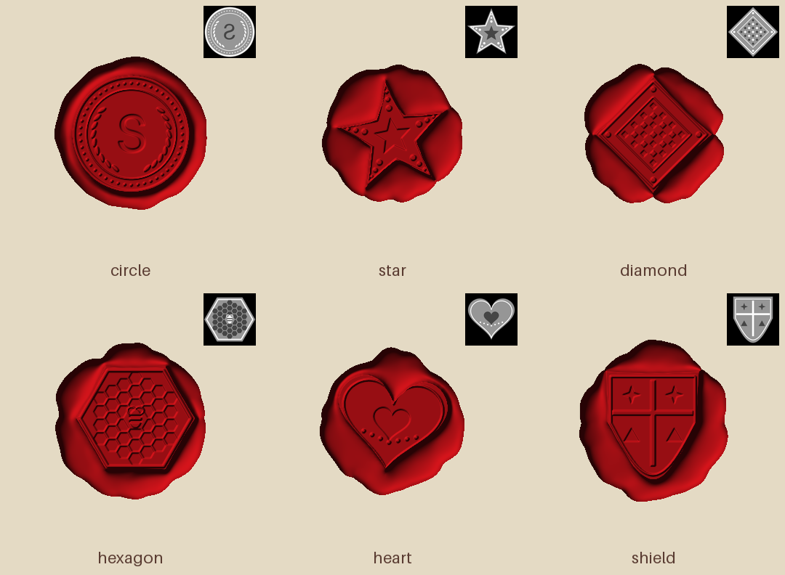
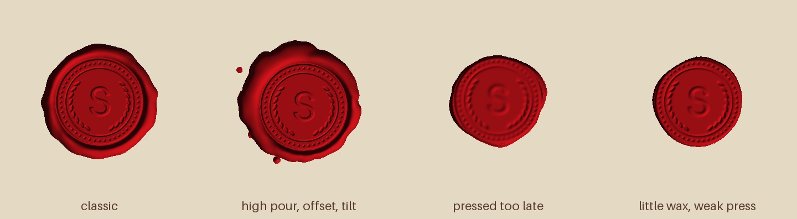

# Splotch

**Капнул, прижал, напечатал.** Физическая симуляция сургучной печати: виртуальный
сургуч наливается, растекается и остывает, в него вдавливается ваш штамп, а
результат экспортируется в STL или 16-битную карту высот.



*Шесть штампов, шесть печатей. В углу каждой плитки показана карта высот штампа.*

[English version](README.md)

## Возможности

- **Налив.** Струя падает с заданной высоты, укладывается витками, растекается
  под собственным весом и остывает. Чем выше налив, тем шире и неровнее лужица,
  а выше ~80 мм появляются брызги.
- **Прижим.** Штамп опускается со смещением, поворотом и наклоном. Вытесненный
  сургуч затекает в полости штампа и выходит наружу валиком. Штамп
  останавливается, когда сила прижима уравновешивается сопротивлением
  остывающего сургуча.
- **Время важно.** Прижмёте поздно, и сургуч успеет схватиться: оттиск выйдет
  мелким или неполным. Мало сургуча, и края рисунка обрежутся.
- **Рандомизация.** Любой параметр симуляции принимает число, диапазон или
  нормальное распределение, так что печати в серии не повторяются.
- **Экспорт.** Замкнутый бинарный STL, 16-битная PNG-карта высот с JSON
  (мм на пиксель, мм для белого), сырой `.npy` и превью.

## Установка

```bash
pip install -r requirements.txt   # numpy, scipy, pillow
```

Нужен Python 3.9 или новее.

## Быстрый старт

```bash
# демо-штамп, чтобы поиграться
python3 splotch.py --make-demo-stamp stamp.png

# одна печать
python3 splotch.py --stamp stamp.png --stamp-size 25 --out seal

# десять случайных печатей
python3 splotch.py --stamp stamp.png --stamp-size 25 --relief-depth 1.2 \
    --volume 1.5 --drop-height 30:80 --force 40~10 \
    --offset-x -1:1 --offset-y -1:1 --rotation 0~3 --tilt 0:2 \
    --count 10 --seed 1 --out seals/seal
```

Готовые штампы (круг, звезда, ромб, шестиугольник, сердце, щит) лежат в
[`examples/stamps/`](examples/stamps), их создаёт
[`examples/make_stamps.py`](examples/make_stamps.py):

```bash
python3 splotch.py --stamp examples/stamps/star.png --stamp-size 26 --volume 2 --out star
```

Одна печать считается около 30 с при шаге сетки 0,15 мм. Для черновиков
используйте `--resolution 0.25` (около 7 с).

## Карта высот штампа

Штамп задаётся картинкой в оттенках серого (8 или 16 бит, PNG/JPG/TIFF). Она
описывает и рельеф, **и форму самого штампа**:

| Пиксель | Значение |
|---|---|
| Яркость | насколько материал штампа выступает к сургучу |
| Цвет «пусто» (по умолчанию чёрный, `--empty white` наоборот) или прозрачность | материала нет; задаёт контур штампа |
| Пустые области внутри контура | самое глубокое углубление рельефа (`--holes-through` делает их сквозными) |

Физический размер: `--stamp-size` — ширина картинки в мм, `--relief-depth` —
перепад высот от «пусто» до белого в мм.

Картинка считается видом **на рабочую грань штампа**, поэтому оттиск
зеркалится. Если картинка уже показывает готовую печать (текст читается
правильно), добавьте `--no-mirror`.

Пример: в [`examples/stamps/circle.png`](examples/stamps/circle.png) чёрный фон
означает пустоту, серый диск — рабочую грань. Белые ободок, точки и листья
выступают (на сургуче станут бороздками), а тёмная «S» утоплена (выйдет
выпуклой). «S» нарисована зеркально, как на настоящем штампе, и на печати
читается правильно.

## Один штамп, разные руки



| Печать | Что изменилось |
|---|---|
| classic | значения по умолчанию, 1,6 см³ |
| high pour, offset, tilt | 2 см³ с высоты 180 мм, 60 Н, штамп смещён на (2; −1,5) мм и наклонён на 2° |
| pressed too late | пауза 12 с перед прижимом: сургуч схватился, оттиск мелкий |
| little wax, weak press | 1,1 см³ и 12 Н: рисунок слабый, края едва сформированы |

Все параметры каждого примера сохранены рядом в `.json` в
[`examples/gallery/`](examples/gallery) и [`examples/conditions/`](examples/conditions).

## Параметры

Любой параметр симуляции задаётся так:

| Запись | Значение |
|---|---|
| `40` | фиксированное значение |
| `30:50` | равномерно случайное в диапазоне |
| `40~5` | нормальное распределение, среднее~сигма |

Отрицательные диапазоны пишутся как есть: `--offset-x -2:2`.

| Опция | По умолчанию | Смысл |
|---|---|---|
| `--volume` | 1.5 | объём сургуча, см³ |
| `--drop-height` | 40 | высота налива, мм |
| `--pour-rate` | 400 | скорость налива, мм³/с |
| `--pour-wobble` | 0.8 | дрожание руки при наливе, мм |
| `--stream-radius` | 1.5 | радиус струи, мм |
| `--temp` / `--ambient` | 115 / 22 | температура сургуча и бумаги, °C |
| `--delay` | 4 | пауза между наливом и прижимом, с |
| `--force` | 40 | сила прижима, Н |
| `--offset-x` / `--offset-y` | 0 | смещение штампа от центра лужицы, мм |
| `--rotation` | 0 | поворот штампа, градусы |
| `--tilt` / `--tilt-dir` | 0 / 0:360 | наклон штампа и его направление, градусы |
| `--press-speed` | 4 | скорость опускания штампа, мм/с |
| `--dwell` | 5 | выдержка под штампом, с |

Константы материала (`--viscosity`, `--visc-slope`, `--yield-stress`,
`--yield-slope`, `--cool-time`, `--stamp-chill`) и численные настройки
(`--resolution`, `--canvas`, `--press-step` и другие) описаны в
`python3 splotch.py --help`.

## Результат

Для каждой печати с префиксом `<prefix>`:

| Файл | Содержимое |
|---|---|
| `<prefix>.stl` | замкнутое тело сургуча; `--stl-base` добавляет подложку, `--stl-step` прореживает сетку |
| `<prefix>_height.png` | 16-битная карта высот; высота в мм = значение / 65535 × `z_mm_at_white` |
| `<prefix>.json` | выпавшие параметры, итог прижима, масштаб карты |
| `<prefix>_preview.png` | превью с освещением |
| `<prefix>_height.npy` | высоты в мм, float (с `--format npy`) |

Форматы выбираются через `--format stl,png,npy`. Чтобы у всей серии был
одинаковый масштаб карты высот, задайте `--hm-zmax`.

## Как это работает

1. **Налив.** Сургуч укладывается вдоль витков дрожащей струи. Растекание
   описывается уравнением тонкого слоя `h_t = ∇·(ρg h³ / 3μ ∇h)`. Вязкость
   экспоненциально растёт при остывании, тонкий край застывает первым. Для
   скорости налив считается на более грубой сетке.
2. **Прижим.** На каждом шаге опускания сургуч, оказавшийся выше поверхности
   штампа, вытесняется полем давления, которое решается в зоне контакта
   (`∇·(K∇p) = источник`, `K ∝ h³`, `p = 0` там, где есть свободное место).
   Сопротивление считается по формуле Прандтля для сжатия пластичного слоя,
   `p ≈ σ_y(T)·(1 + R / 3h)`.
3. **Выдержка и подъём.** Под холодным штампом сургуч остывает быстрее. После
   подъёма штампа он ненадолго оплывает.

## Ограничения

- Модель 2.5D: нет нависаний, пузырей воздуха и нитей сургуча, которые тянутся
  за штампом при раннем подъёме.
- Константы материала подобраны на глаз под правдоподобный результат, а не
  измерены. Если оттиски слишком мелкие или глубокие для вашей силы прижима,
  в первую очередь крутите `--yield-stress`.

## Лицензия

[MIT](LICENSE)
